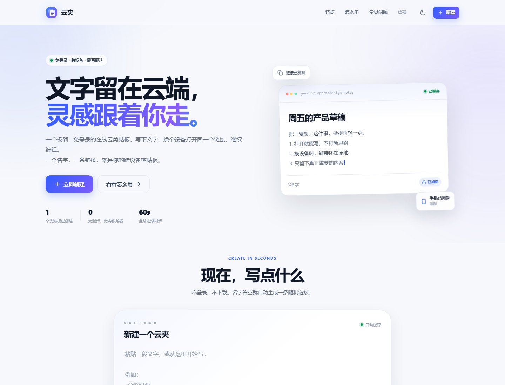
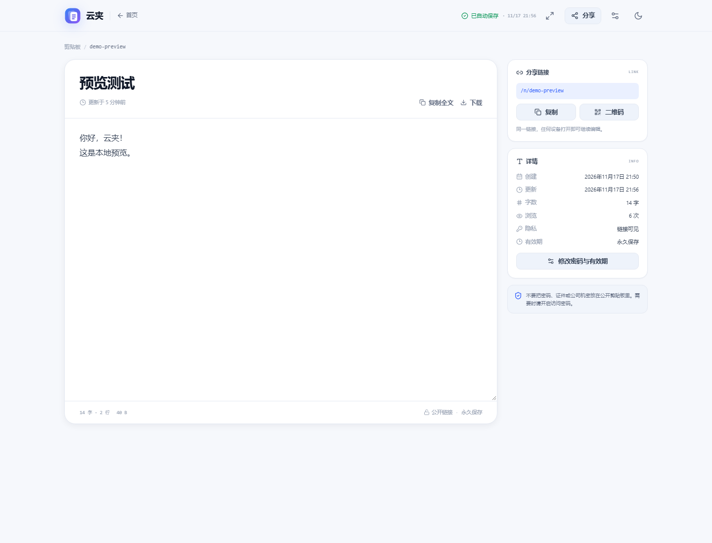
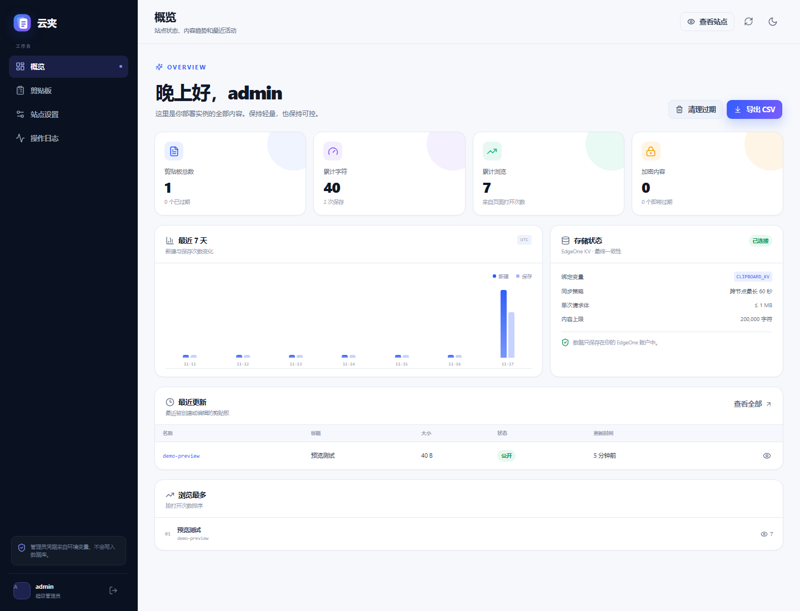

# 云夹 · YunClip

> 文字留在云端，灵感跟着你走。

一个参考 [webnote.cc](https://webnote.cc/) 思路搭建的极简在线云剪贴板。无需注册，打开网页写下内容，换一台设备打开同一个链接就能继续编辑。

项目使用 **React + Vite（开发）+ EdgeOne Pages Edge Functions + EdgeOne KV**，不依赖传统服务器和数据库。自带一个由环境变量绑定的单管理员后台，可查看内容、清理过期数据、调整站点规则和导出 CSV。



| 编辑页 | 管理后台 |
| --- | --- |
|  |  |

## 功能

### 公开侧

- **免登录，链接即用**：名字就是链接，例如 `https://your-domain.com/n/demo`。
- **自动保存**：停止输入约 900ms 后自动写入，无需点击保存。
- **跨设备编辑**：电脑、手机、平板打开同一条链接即可继续。
- **访问密码**：单条剪贴板可使用 PBKDF2 哈希密码保护。
- **有效期**：1 小时、6 小时、1 天、3 天、7 天、30 天或永久。
- **二维码分享**：本地生成二维码，不请求第三方接口。
- **深色模式、专注模式、字数统计、下载、复制全文**。
- **冲突提醒**：内容在另一台设备被修改时暂停自动保存，可选择载入云端版本或保留本地版本。
- **移动端适配**：390px 宽度下无横向溢出。

### 管理侧（单管理员）

- 管理员账号只来自环境变量，不存在注册入口或用户表。
- 概览：剪贴板数量、累计字符、浏览量、加密内容、7 天趋势。
- 剪贴板管理：搜索、状态筛选、排序、查看正文、删除、分页。
- 站点设置：站点名称、标语、描述、公告、页脚文案、是否允许新建、内容上限、默认有效期。
- 操作日志：登录、删除、设置变更等审计记录。
- CSV 导出、过期内容批量清理。
- HttpOnly 签名会话 + 登录限流。

## 技术栈

| 层 | 技术 |
| --- | --- |
| 前端 | React 19、TypeScript、React Router、Lucide Icons、qrcode.react |
| 构建 | Rollup + Terser（生产构建，无额外运行时服务） |
| 开发 | Vite + 本地 Node API 适配器 |
| 边缘接口 | EdgeOne Pages Edge Functions（JavaScript / Web APIs） |
| 存储 | EdgeOne KV |
| 部署 | EdgeOne Pages + GitHub 自动部署 |

生产构建没有使用 `vite build`，而是 `scripts/build.mjs` 中的 Rollup 构建流程；这样在受控环境和 EdgeOne 构建机上都不依赖额外的原生 bundler 子进程。Vite 仅用于本地开发。

## 目录结构

```text
.
├── edge-functions/
│   └── api/
│       └── [[default]].js   # /api/* 的 Edge Function 入口
├── server/
│   ├── app.js               # 路由、限流、管理接口
│   ├── auth.js              # 管理员凭据、HMAC 会话
│   ├── http.js              # JSON/Cookie/编码/CSRF 工具
│   ├── notes.js             # 剪贴板领域逻辑、密码、统计
│   ├── settings.js          # 站点设置与有效期
│   └── store.js             # EdgeOne KV 适配器 + 测试内存实现
├── src/
│   ├── pages/               # 首页、编辑页、后台登录、后台
│   ├── components/          # 布局、弹窗、Logo、Toast
│   ├── contexts/            # 站点配置、通知
│   ├── lib/                 # API、类型、格式化、最近记录
│   ├── styles.css           # 完整设计系统
│   └── main.tsx
├── scripts/
│   ├── build.mjs            # 生产构建
│   ├── dev.mjs              # Vite + 本地 API
│   ├── serve.mjs            # 构建产物 + API 预览
│   ├── generate-assets.py   # 图标和 OG 图生成
│   └── lib/                 # 本地 KV、Node HTTP 适配器
├── tests/api.test.mjs       # 后端集成测试
├── edgeone.json             # EdgeOne 构建、SPA fallback、安全头
└── .env.example
```

## 本地运行

要求 Node.js **20.19+**（推荐 22 LTS）。

```bash
npm install
cp .env.example .env
# 编辑 .env，至少设置 ADMIN_PASSWORD
npm run dev
```

打开 <http://127.0.0.1:5173>。API 运行在 8787，由 Vite 代理。

如果未配置 `.env`，本地会使用：

- 管理员：`admin`
- 密码：`dev-password`
- 数据：`.dev-kv.json`（已加入 .gitignore）

重置本地数据只需删除 `.dev-kv.json`。

### 测试与构建

```bash
npm test          # 后端集成测试
npm run check     # TypeScript 类型检查
npm run build     # 类型检查 + Rollup 生产构建，输出 dist/
npm run preview   # 构建后启动 http://127.0.0.1:4173
```

## 环境变量

在 EdgeOne 项目的「项目设置 → 环境变量」中添加。变量只注入 Edge Functions，不会打包进前端。

| 变量 | 必填 | 默认值 | 说明 |
| --- | --- | --- | --- |
| `ADMIN_USERNAME` | 否 | `admin` | 唯一管理员登录名。 |
| `ADMIN_PASSWORD` | 二选一 | 无 | 管理员明文密码。只应存在于部署平台环境变量。 |
| `ADMIN_PASSWORD_SHA256` | 二选一 | 无 | 管理员密码的 64 位 SHA-256 十六进制摘要，优先级高于 `ADMIN_PASSWORD`。 |
| `SESSION_SECRET` | 强烈建议 | 由管理员凭据派生 | HMAC 会话签名密钥，建议 64 位随机字符串。 |
| `SESSION_TTL_HOURS` | 否 | `24` | 管理员会话有效期，1–720 小时。 |
| `KV_BINDING_NAME` | 否 | `CLIPBOARD_KV` | KV 绑定变量名；只有你改了绑定名才需要设置。 |
| `COOKIE_SECURE` | 否 | 自动 | 本地 HTTPS 调试时可设为 `true`。生产环境会按 HTTPS 自动加 Secure。 |

生成随机密钥：

```bash
node -e "console.log(require('crypto').randomBytes(32).toString('hex'))"
```

生成密码摘要：

```bash
node -e "console.log(require('crypto').createHash('sha256').update('你的密码').digest('hex'))"
```

> 修改管理员密码或 `SESSION_SECRET` 后重新部署，旧会话会失效。
>
> 如果没有设置 `SESSION_SECRET`，代码会从管理员凭据派生一个密钥，保证开箱可用；但生产环境请显式设置随机值。

## 部署到 EdgeOne Pages

### 1. 上传 GitHub

```bash
git init -b main
git add .
git commit -m "feat: initial yunclip"
git remote add origin https://github.com/<your-name>/yunclip.git
git push -u origin main
```

仓库不需要提交 `.env`、`dist/`、`node_modules/` 或 `.dev-kv.json`。

### 2. 在 EdgeOne Makers 创建项目

1. 登录 EdgeOne Makers 控制台。
2. **Create project → Import Git Repository**，选择刚刚的仓库。
3. 构建配置：
   - Root Directory：`/`
   - Install Command：`npm install --include=dev`
   - Build Command：`npm run build`
   - Output Directory：`dist`
   - Node Version：`22.11.0`
4. 项目根目录的 `edgeone.json` 已经声明了同样的构建配置、SPA fallback 和安全响应头，通常无需手动改。

> EdgeOne 会识别项目根目录的 `edge-functions/` 并部署为 Edge Functions。`/api/*` 由 `edge-functions/api/[[default]].js` 统一处理。

### 3. 开通并绑定 KV

1. 在 EdgeOne 控制台进入 **存储 → KV**，按页面提示申请 / 开通 KV 服务（如果当前账号需要 allowlist）。
2. 创建一个命名空间，例如 `yunclip-prod`。
3. 进入 Pages 项目 → **KV 存储 → 绑定命名空间**，变量名填写 **`CLIPBOARD_KV`**。
4. 如果使用别的变量名，在环境变量中添加 `KV_BINDING_NAME`，值与绑定名一致。

绑定完成后打开：

```text
https://你的域名/api/health
```

应看到 `"storageConfigured": true` 和 `"storageOk": true`。

### 4. 配置管理员环境变量

在项目设置中添加：

```text
ADMIN_USERNAME=admin
ADMIN_PASSWORD=一个足够长的随机密码
SESSION_SECRET=64位随机字符串
```

或者用 `ADMIN_PASSWORD_SHA256` 替代 `ADMIN_PASSWORD`。

保存后**重新部署**一次，确保 Edge Functions 读取到新变量。

### 5. 访问

- 首页：`https://你的域名/`
- 后台：`https://你的域名/admin`
- 分享链接：`https://你的域名/n/剪贴板名称`

建议绑定自己的域名并开启 HTTPS。`edgeone.json` 的 CSP 只允许同源请求和同源脚本，不需要额外放行第三方域名。

### 部署排障

| 现象 | 排查 |
| --- | --- |
| 后台提示「管理员账号尚未配置」 | 确认 `ADMIN_PASSWORD` 或 `ADMIN_PASSWORD_SHA256` 已在生产环境配置，并重新部署。 |
| 接口返回 `STORAGE_NOT_CONFIGURED` | 确认 KV 命名空间已绑定到项目，变量名为 `CLIPBOARD_KV`（或设置了 `KV_BINDING_NAME`）。 |
| 直接打开 `/n/xxx` 或 `/admin` 出现 404 | 确认 `edgeone.json` 中保留了 `"source": "/*", "destination": "/index.html"` 的精确 SPA fallback 配置。 |
| 修改内容后另一台设备延迟看到 | EdgeOne KV 最终一致性，跨节点最长约 60 秒；等待后刷新。 |
| 登录后马上又退出 | 检查是否在 HTTPS 下访问、`SESSION_SECRET` 是否稳定、部署是否切换了环境变量。 |

## API 一览

所有响应默认 `Cache-Control: no-store`。

### 公开接口

| 方法 | 路径 | 说明 |
| --- | --- | --- |
| `GET` | `/api/health` | 健康检查与 KV 状态。 |
| `GET` | `/api/site` | 站点设置、公开统计。 |
| `POST` | `/api/notes` | 创建剪贴板。 |
| `GET` | `/api/notes/:slug` | 读取；加密内容需请求头 `x-note-password`。加 `?visit=1` 记录浏览。 |
| `PUT` | `/api/notes/:slug` | 更新；建议携带 `version` 做冲突检测。 |
| `DELETE` | `/api/notes/:slug` | 删除；需 body `{ "confirm": "slug" }`，加密内容需密码。 |

创建示例：

```bash
curl -X POST https://你的域名/api/notes \
  -H 'content-type: application/json' \
  -d '{"slug":"demo","title":"示例","content":"你好，云夹"}'
```

更新示例：

```bash
curl -X PUT https://你的域名/api/notes/demo \
  -H 'content-type: application/json' \
  -d '{"content":"新内容","version":1}'
```

### 管理接口

| 方法 | 路径 | 说明 |
| --- | --- | --- |
| `POST` | `/api/admin/login` | 登录，写入 HttpOnly 会话 Cookie。 |
| `POST` | `/api/admin/logout` | 退出。 |
| `GET` | `/api/admin/session` | 当前会话。 |
| `GET` | `/api/admin/stats` | 概览统计、7 天趋势、最近更新。 |
| `GET` | `/api/admin/notes` | 列表；支持 `q`、`filter`、`sort`、`page`、`limit`。 |
| `GET` | `/api/admin/notes/:slug` | 查看正文（管理员可查看加密内容）。 |
| `DELETE` | `/api/admin/notes/:slug` | 删除。 |
| `GET/PUT` | `/api/admin/settings` | 读取 / 保存站点设置。 |
| `GET` | `/api/admin/audit` | 最近操作日志。 |
| `POST` | `/api/admin/cleanup` | 清理过期剪贴板。 |
| `GET` | `/api/admin/export` | 导出 CSV。 |

## KV 数据布局

EdgeOne KV 的 key 只允许数字、字母和下划线，因此 slug 使用 UTF-8 十六进制编码。

| Key | 内容 |
| --- | --- |
| `note_<hex(slug)>` | 完整笔记 JSON（正文、版本、密码哈希、过期时间等）。 |
| `idx_<hex(slug)>` | 列表用元数据，不含正文。 |
| `pv_<hex(slug)>` | 独立浏览计数，避免浏览写入覆盖正文。 |
| `config_site` | 站点设置。 |
| `stat_global` | 全局计数。 |
| `stat_day_YYYYMMDD` | 每日新建 / 保存 / 浏览计数。 |
| `audit_<timestamp>_<random>` | 管理员操作审计。 |
| `rate_<scope>_<hex>` | 创建、登录、密码尝试的限流计数。 |

### 容量与限制

- EdgeOne Edge Functions 单次请求 body 上限约 **1 MB**。
- KV 单 value 上限 **25 MB**，单账户约 **1 GB**。
- 本项目默认单条内容 200,000 字符，管理后台可调，硬上限 300,000 字符。
- 后台列表最多扫描 3,000 条索引；个人使用足够，大规模公开服务应换成数据库。
- KV 是最终一致性存储：同一节点写入后立即可读，不同节点最长约 60 秒同步。

## 安全设计

- 管理员凭据只来自环境变量；没有默认生产密码，没有注册接口。
- 管理员会话使用 HMAC-SHA256 签名，Cookie 为 `HttpOnly` + `SameSite=Lax`；HTTPS 下自动加 `Secure`。
- 会话 payload 包含密码指纹，修改管理员密码后旧会话自动失效。
- 登录失败使用统一提示，并对 IP 做 8 次 / 10 分钟限流。
- 管理写操作校验 `Origin` / `Sec-Fetch-Site`，降低 CSRF 风险。
- 剪贴板密码使用 PBKDF2-SHA256（25,000 次迭代）+ 随机盐，只保存哈希。
- 创建、密码尝试均有 KV 限流（最终一致性，非强一致配额）。
- 响应带 CSP、`X-Frame-Options: DENY`、`X-Content-Type-Options: nosniff`、Referrer-Policy 等安全头。
- React 默认转义正文，不渲染用户 HTML。
- CSV 导出对公式前缀做转义，降低 Excel 公式注入风险。

### 必须知道的边界

1. **这不是端到端加密。** 密码只控制访问，KV 中的正文仍是明文。不要存放重要机密。
2. **链接本身就是默认访问凭证。** 任何拿到链接的人都能查看和编辑公开剪贴板。
3. **密码无法找回。** 忘记密码只能由管理员删除后重建。
4. **KV 不是强一致数据库。** 多设备同时编辑时依赖版本冲突提示，最后写入者可能覆盖，请使用「载入云端」或「保留我的」明确选择。
5. **管理员后台不是隐藏入口。** `/admin` 可被访问，但必须通过环境变量中的账号密码登录。
6. **限流是最佳努力。** EdgeOne KV 边缘缓存意味着短时间内的计数可能不绝对精确。

## 自定义

- **站点名称 / 文案 / 公告 / 新建开关**：登录 `/admin` → 站点设置。
- **颜色和圆角**：`src/styles.css` 顶部的 `--brand`、`--bg` 等变量。
- **默认设置**：`server/settings.js` 的 `DEFAULT_SETTINGS`。
- **Logo / 图标**：`public/favicon.svg`、`scripts/generate-assets.py`（生成 PNG、ICO、OG 图）。
- **首页文案**：`src/pages/HomePage.tsx`。
- **站点标题 / SEO**：`index.html` 和 `src/pages/*` 中的 `document.title`。

## GitHub Actions

仓库包含 `.github/workflows/ci.yml`，在 push / PR 时执行：

- pnpm 安装依赖
- 后端集成测试
- TypeScript 类型检查 + 生产构建

EdgeOne 的部署由 EdgeOne 的 GitHub 集成完成，CI 只做质量门禁。

## 常见问题

**Q：能传文件或图片吗？**

当前专注文字。文件会显著增加 KV 体积和流量成本，也会偏离「极简剪贴板」的定位。

**Q：多人可以同时编辑吗？**

可以打开同一条链接，但不是实时协作。保存时用版本号检测冲突，并提示选择保留哪一份。

**Q：如何备份数据？**

管理员后台可以导出 CSV 元数据；正文需要从 KV 控制台或自行扩展导出接口获取。生产使用前建议确认 EdgeOne KV 的备份策略。

**Q：为什么不用数据库？**

这是个人 / 小团队的自托管项目，KV 足够轻，部署成本低。需要复杂查询、强一致和大规模时请换 Postgres / D1 等。

## License

MIT。参考产品 [webnote.cc](https://webnote.cc/) 的产品形态，代码为独立实现。
